# ha-tray-panel

Home Panel (*Ev Paneli* in Turkish) is a Windows tray app for [Home Assistant](https://www.home-assistant.io/). It gives you a quick panel for your favorite devices, a keyboard-driven command palette and global hotkeys, with your full dashboard one click away.

English | [Türkçe](README.tr.md)

<p align="center">
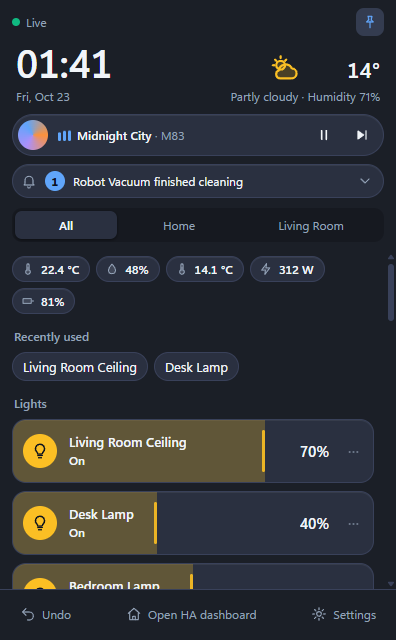
&nbsp;
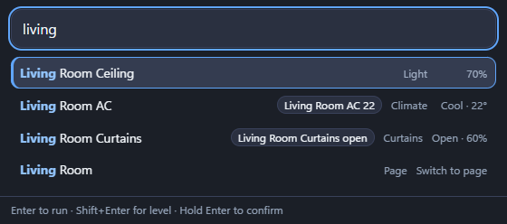
</p>

## Features

- Tray icon with a quick panel: a clock with the weather and a now-playing strip at the top, lights, scenes, media and PC actions, plus a "recently used" row. A light is a compact row that fills to its brightness: drag sideways on it, use Shift + ← / → or the mouse wheel to dim, and open ⋯ for presets, the slider and colours. Each tile shows its icon in a round badge, and a ✓ or ! badge shows whether Home Assistant did it.
- A small corner notification after each action with the device's icon, its name and what happened, for example "Turned off" or "Brightness 80%".
- Command palette (`Ctrl+Alt+P`) with fuzzy search. Typing `desk 40` sets a light to 40%, `desk 0` turns it off.
- Global hotkeys for the main window, the palette, any favorite and any dashboard. The shortcut fields record the keys you press.
- Your Home Assistant dashboard in a compact or wide window that hides when it loses focus.
- Live state over the Home Assistant WebSocket API, with REST polling as a fallback.
- Home and external addresses: the app tries the home address first and falls back to the external one.
- Command line actions for Stream Deck, Task Scheduler and scripts: `"Ev Paneli.exe" --eylem="desk 40"`.
- Cards for climate, media players, vacuums, fans, dehumidifiers, selects, numbers and timers, and colour and white-tone controls for lights. The climate card has a heat/cool range, fan mode and preset; media cards seek 10 seconds; sensor tiles can have a gauge range and a chart style.
- Curtain and blind cards (open, stop, close, position), valve and automation cards. Valves and automations always need a press-and-hold, and they never run from a hotkey or the command line.
- Optional camera snapshots (a still picture, no live video): off by default, you approve each camera in Settings, the picture starts blurred, stays in memory only, and the panel is hidden from screen capture while a camera is allowed. A camera card can be enlarged or refreshed on demand.
- Optional info cards: a sensor strip with charts, a clock with weather and a forecast, a read-only calendar and to-do lists. Media cards show the album cover.
- Right-click menu, pages (tabs), grouping by room, tile icon, colour and size, reordering with an undo history, and tiles pinned to the desktop. The tile menu can pin a favorite to the desktop, tile symbols come from a searchable emoji picker, and the palette can open the panel on a chosen page.
- An optional badge on the tray icon: the number of lights that are on, or up to three sensors shown in turn every 5 seconds.
- Undo (`Ctrl+Alt+Z`), delayed actions (`desk off in 10 min`) and a local activity history that shows which action ran from where.
- Notifications in the panel for Home Assistant messages, low batteries and updates, with alert rules and quiet hours. Desktop notifications are optional.
- Optional external triggers, all off by default: Jump List tasks, desktop shortcuts, `evpaneli://` links, a local API on 127.0.0.1, PC events (lock, sleep) and a meeting light. They run only harmless favorites that you pick by name.
- Optional Home Assistant mobile app registration, so notifications from `notify.mobile_app_*` arrive on the PC with action buttons.
- Connection options for harder setups: custom HTTP headers (for example Cloudflare Access), a private root CA or a pinned certificate, browser sign-in, and settings sync through a folder you choose.
- Light, dark and high-contrast themes with preset or custom colours, text size, Windows 11 mica/acrylic, and an interface in English, Turkish, German, French and Spanish.
- Settings grouped into categories on the left (Connection, Favorites, Appearance and more), with search across all of them. Settings export/import with automatic backups, a diagnostics report without secrets, and an update check and in-app updates that are both off by default. An import shows a preview before anything is applied.
- A portable build that needs no installation. It shares its settings folder with the installed app, so avoid running 1.3.0 or older next to this version: they rewrite the settings file without the newer fields (favorites, tile fields, language). The app restores them from the saved older-version backup on its next start.

## Screenshots

All screenshots use a made-up demo home, not a real one.

<table>
<tr>
<td align="center" valign="top"><br><sub>Quick panel</sub></td>
<td align="center" valign="top">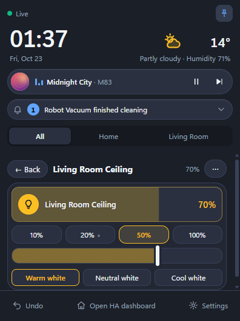<br><sub>Lights</sub></td>
<td align="center" valign="top">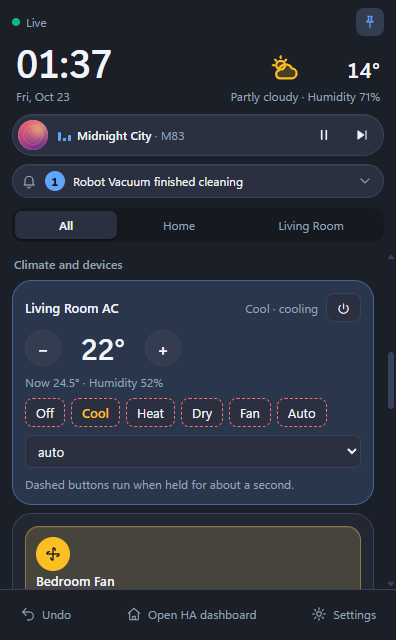<br><sub>Climate and fan</sub></td>
</tr>
<tr>
<td align="center" valign="top">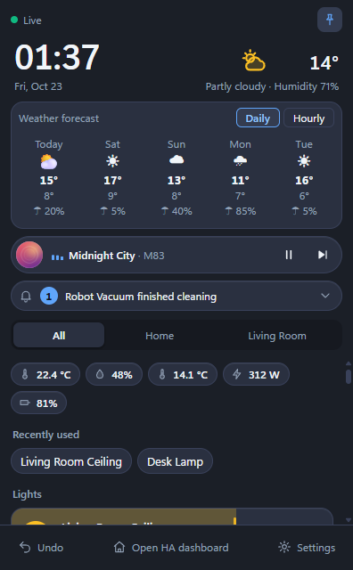<br><sub>Forecast and sensors</sub></td>
<td align="center" valign="top">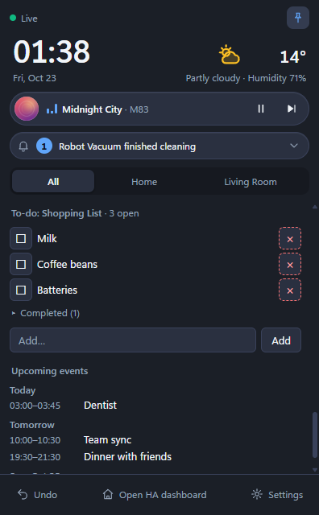<br><sub>To-do list and calendar</sub></td>
<td align="center" valign="top">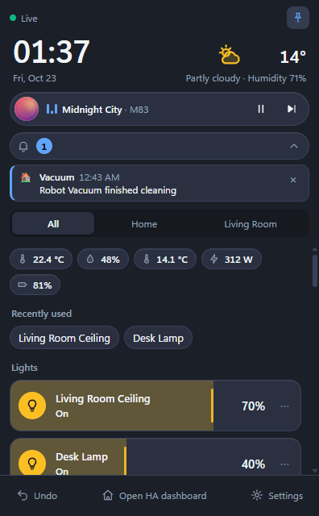<br><sub>Notifications</sub></td>
</tr>
<tr>
<td align="center" valign="top">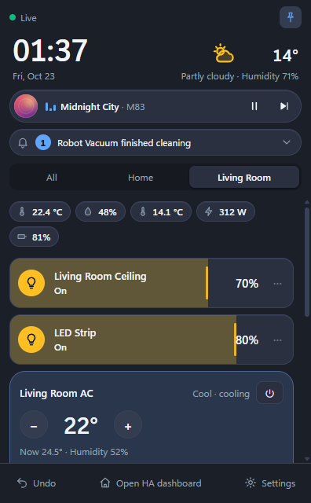<br><sub>Pages</sub></td>
<td align="center" valign="top">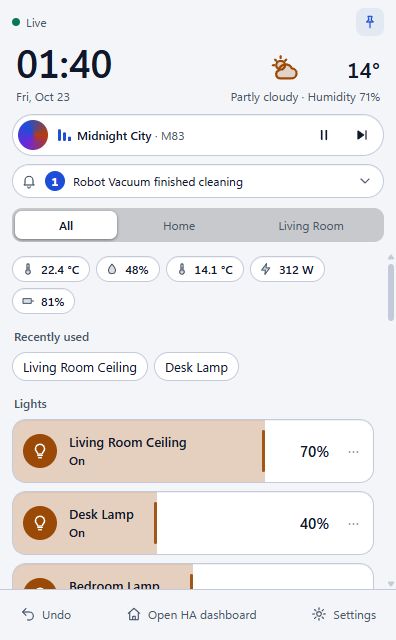<br><sub>Light theme</sub></td>
</tr>
</table>

### Corner notification

<p>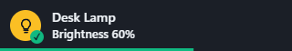<br>
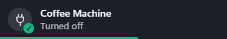</p>

### Command palette

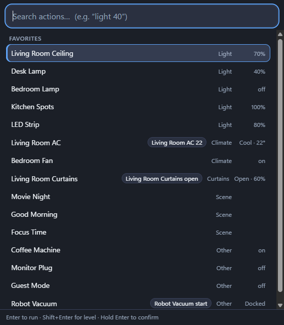

<details>
<summary>More palette examples</summary>

<p><br><sub>Search across devices, scenes and pages</sub></p>
<p>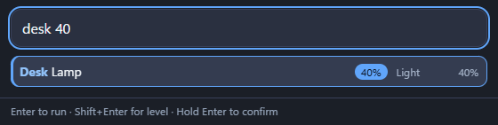<br><sub><code>desk 40</code> sets a light to 40%</sub></p>
<p>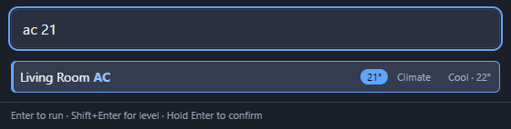<br><sub><code>ac 21</code> sets the target temperature</sub></p>
<p>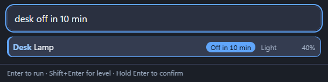<br><sub><code>desk off in 10 min</code> schedules an action</sub></p>
<p>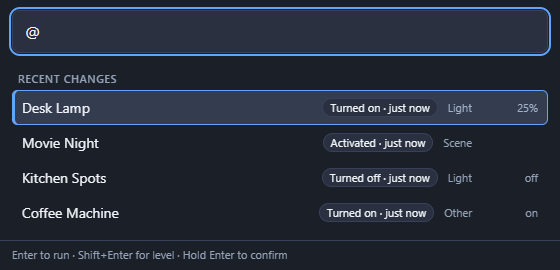<br><sub><code>@</code> lists what changed recently</sub></p>
<p>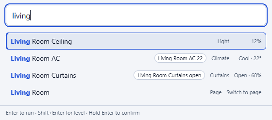<br><sub>Light theme</sub></p>

</details>

<details>
<summary>Settings</summary>

<p>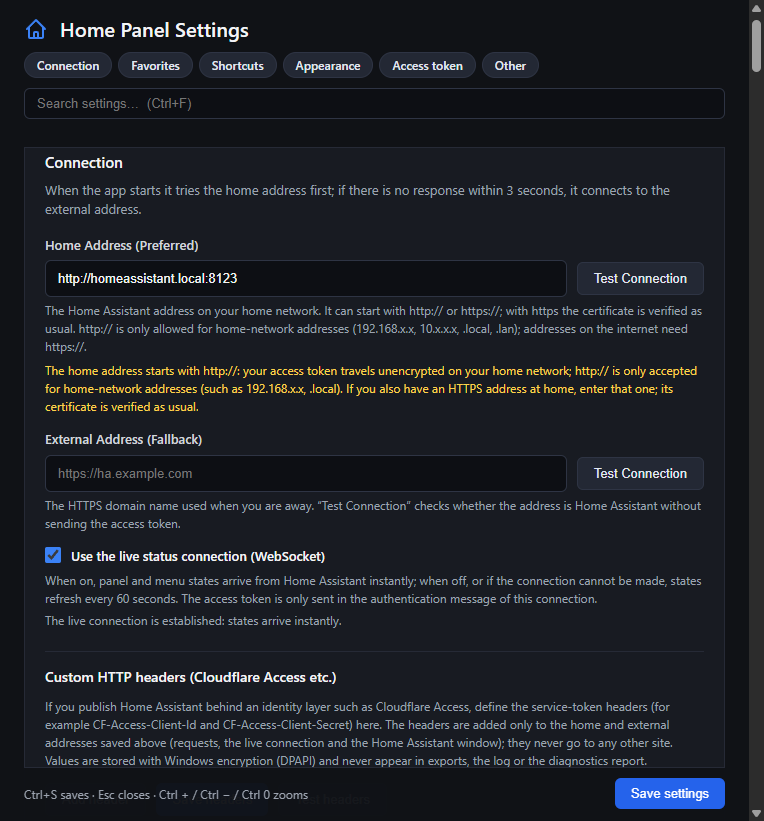<br><sub>Connection</sub></p>
<p>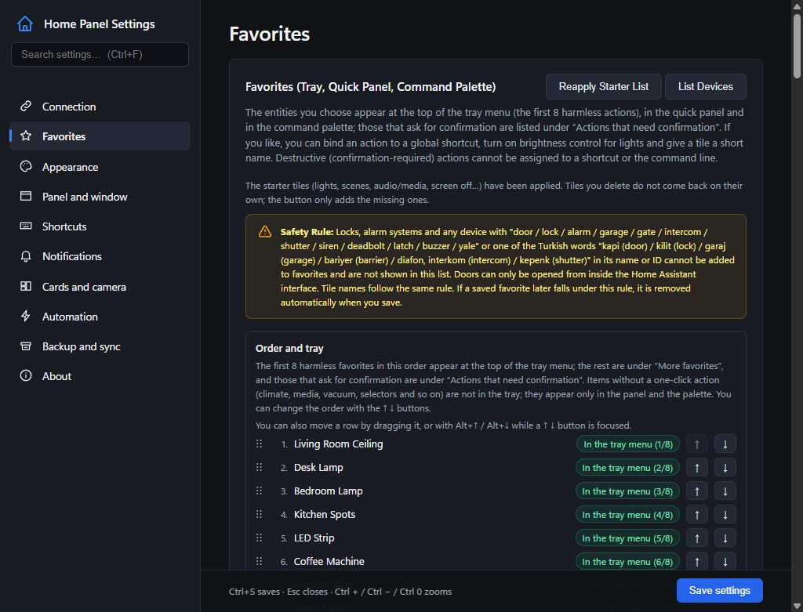<br><sub>Favorites and the safety rule</sub></p>
<p>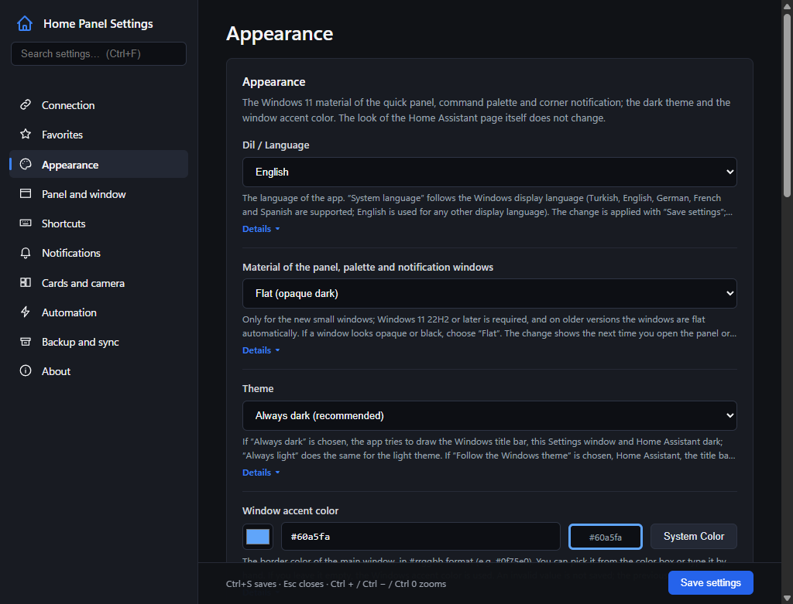<br><sub>Appearance and language</sub></p>

</details>

## Safety

The app controls real devices, so a few rules are built in and are not configurable:

- Locks, alarm panels, sirens, doors, garage doors, gates, intercoms, shutters and similar devices are never listed, added to favorites, bound to a hotkey or run. Scenes that contain them are blocked too.
- Doorbell, door, entrance and intercom cameras are never listed or shown. Only curtains, blinds, shades and awnings count as covers; garage doors, gates and shutters stay blocked.
- Actions such as shutting down a PC, closing a valve or running an automation need a press-and-hold (about one second) to run.
- The access token is encrypted with Electron `safeStorage` (Windows DPAPI). It never goes into logs or exports, and an address is checked without the token before the token is sent to it.
- Valves, automations and cameras, and anything that asks for confirmation, can never be started from outside the app (external triggers, local API, links, PC events).
- If Home Assistant rejects the token, the app stops using it everywhere instead of retrying, so it will not trigger Home Assistant's IP ban.
- Nothing is sent to anyone but your Home Assistant unless you opt in (update check, in-app updates). There is no telemetry, and your address and token never go to a third party.
- Plain `http://` is only accepted for local network addresses.

## Requirements

- Windows 11 (x64). Windows 10 should work but has not been tested.
- Home Assistant with a [long-lived access token](https://www.home-assistant.io/docs/authentication/#your-account-profile).
- Node.js 24 to build from source.

## Installation

Download `Ev-Paneli-Kurulum-<version>.exe` from the [latest release](https://github.com/emre-pn/ha-tray-panel/releases/latest) and run it. It installs for the current user and does not need admin rights.

The installer is not code-signed, so Windows SmartScreen may warn you the first time (More info → Run anyway). Each release lists the SHA-256 checksum of the installer if you want to verify the download.

### Building from source

```bash
git clone https://github.com/emre-pn/ha-tray-panel.git
cd ha-tray-panel
npm ci
npm run dist
```

The installer ends up in `dist/`.

## Getting started

1. Right-click the tray icon and open Settings.
2. Enter your home address (for example `http://homeassistant.local:8123`) and, if you have one, an external HTTPS address.
3. Paste a long-lived access token.
4. Pick your favorites. They show up in the tray menu, the quick panel and the palette.

The interface language follows Windows by default. You can change it under Settings → Appearance → Language.

## Development

```bash
npm start          # run in development mode
npm test           # run the test suite (no Home Assistant needed)
npm run kontrol    # static checks
npm run ikon       # regenerate the icons
npm run dist       # build the Windows installer
npm run dist:tasinabilir   # build the portable exe (no installer)
```

The code, comments and identifiers are in Turkish. Tests never talk to a real Home Assistant; all network calls are mocked. A detailed manual in Turkish is in [docs/KILAVUZ.md](docs/KILAVUZ.md), and the release notes are in [CHANGELOG.md](CHANGELOG.md).

## Contributing

Bug reports, translation fixes and pull requests are welcome. Please read [CONTRIBUTING.md](CONTRIBUTING.md) first. Security issues should be reported privately as described in [SECURITY.md](SECURITY.md).

## License

[MIT](LICENSE) © Emre Sav ([@emre-pn](https://github.com/emre-pn))

This project is not affiliated with Home Assistant or Nabu Casa.
